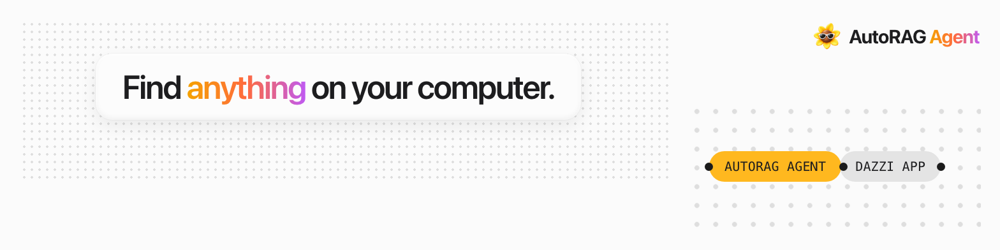
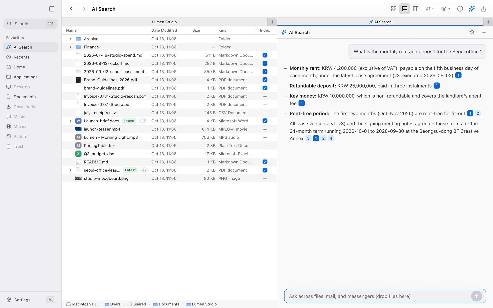
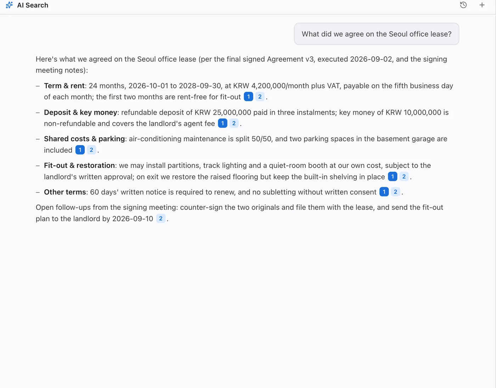
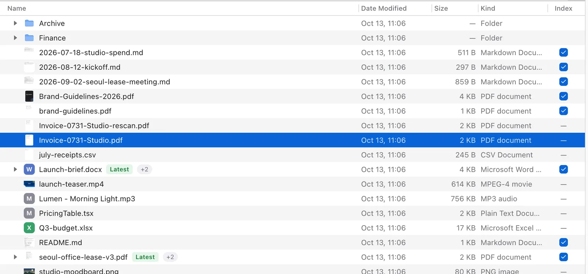
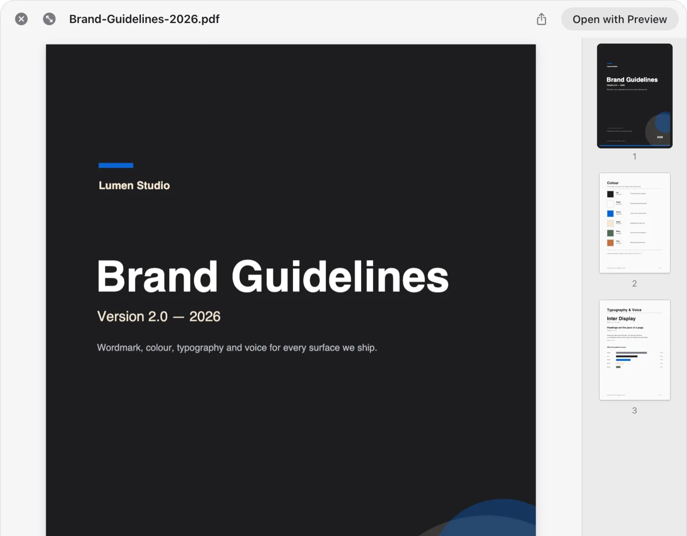
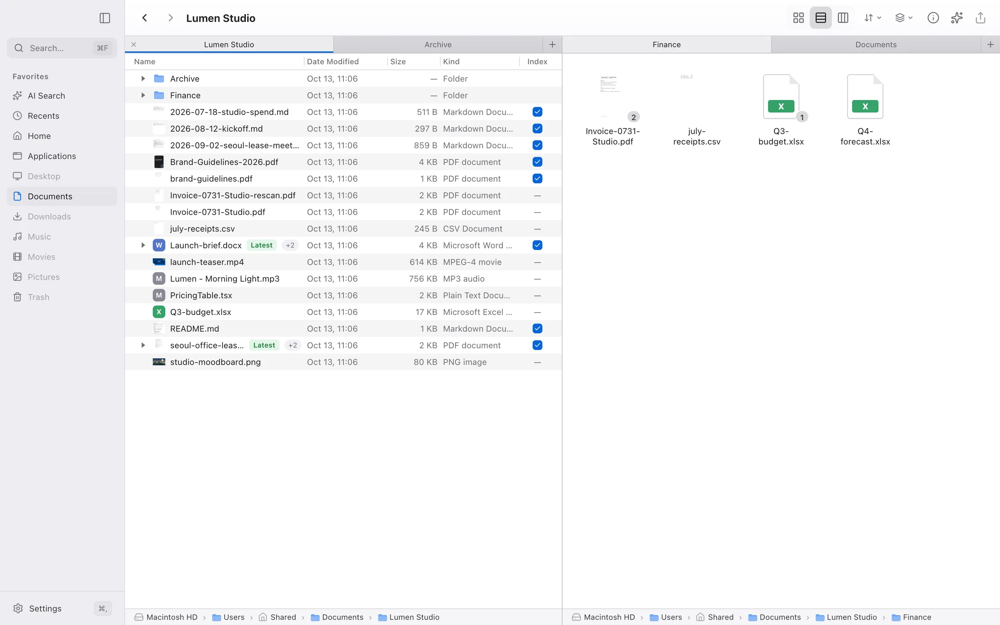
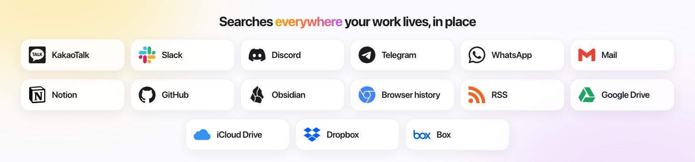

<p align="center">
  
</p>

# AutoRAG Agent

**Your personal librarian agent: it finds, reads, and cites anything on your computer.**

<p align="left">
  <a href="https://www.npmjs.com/package/@autorag/librarian"></a>
  <a href="https://www.npmjs.com/package/@autorag/librarian"></a>
  <a href="https://github.com/Marker-Inc-Korea/AutoRAG/stargazers"></a>
  <a href="https://github.com/Marker-Inc-Korea/AutoRAG/actions/workflows/ci.yml"></a>
  <a href="LICENSE"></a>
  = 24" />
  = 1.2" />
</p>

## Dazzi: the AutoRAG desktop app

**Dazzi is the app version of AutoRAG Agent.** Download it for Mac and Windows at [**dazziapp.com**](https://dazziapp.com), or build from [NomaDamas/AutoRAG-app](https://github.com/NomaDamas/AutoRAG-app). It is a real file manager with the AutoRAG engine in this repository behind it.

<p align="center">
  
</p>

- **Fast file search.** Hybrid keyword + meaning search with a reranker finds files by what is inside them, and every answer links the passage it came from.
- **Messengers, mail, and more.** Slack, KakaoTalk, Discord, Telegram, WhatsApp, every inbox you sign in to, GitHub, and Obsidian are searched alongside your files.
- **Preview anything.** Press Space for Quick Look: Markdown, code, PDF, video, audio, Office, and HWP/HWPX, without opening another app.
- **File-based automations.** Watch a folder, pick a trigger, and let the agent triage or organize new files for you.
- **Duplicate detection.** `final`, `final-v3`, and `(1)` copies collapse into one row tagged Latest, Similar, or Identical.
- **Remote access.** Open your running Dazzi from a phone or another computer over your Wi-Fi or an internet tunnel, paired with a 6-digit code or QR.
- **A real Finder.** Tabs, split panes, light and dark mode, and Korean, English, Japanese, and Simplified Chinese.

> [!IMPORTANT]
> **Looking for the original AutoRAG (RAG AutoML / pipeline optimization tool)?**
> This repository now hosts **AutoRAG 2.0**, a complete reimagining of AutoRAG as a personal librarian agent for your office work. The original Python-based AutoRAG — the RAG AutoML tool for automatically finding an optimal RAG pipeline for your data — now lives in the [`legacy/`](legacy/) directory of this repository.
>
> **The legacy AutoRAG is NOT abandoned.** It continues to be maintained (bug fixes, dependency updates, and PyPI releases via `pip install AutoRAG`) in maintenance mode. Existing users can keep using it exactly as before — see the [legacy README](legacy/README.md) for its documentation, and file issues in this repository as usual. New feature development is focused on AutoRAG Agent (2.0).

---

### What you can do in the app

<table>
<tr>
<td width="50%" valign="top">

### 🔎 Just ask

Ask the way you'd ask a teammate. The librarian reads the files and writes back,
every claim linked to the passage behind it. Drag files, folders, or links into
a question to ask about just those.

</td>
<td width="50%" valign="top">



</td>
</tr>
<tr>
<td width="50%" valign="top">



</td>
<td width="50%" valign="top">

### 🗂️ Spot the twins

`proposal-final`, `proposal-v3`, `proposal (1)`: stacked into one row, newest
on top, tagged **Latest**, **Similar**, or **Identical**. Powered by
[dupey](https://github.com/NomaDamas/dupey), the same scan as
`autorag duplicates`.

</td>
</tr>
<tr>
<td width="50%" valign="top">

### ⌨️ Space to see anything

Markdown, code, PDF, video, audio, Office, and HWP/HWPX previewed instantly in
Quick Look. HWP pages are drawn locally by
[rhwp](https://github.com/edwardkim/rhwp); Hancom Office is not required.

</td>
<td width="50%" valign="top">



</td>
</tr>
<tr>
<td width="50%" valign="top">



</td>
<td width="50%" valign="top">

### 🪟 A real file manager

Tabs and split panes: drag a tab to an edge to split, and every pane keeps its
own tabs, so a folder and a conversation sit side by side. Folders update live
as other apps change them.

</td>
</tr>
</table>

**And more:** hybrid keyword + meaning search with a reranker · scheduled
re-indexing that runs even while the app is closed · an *Ask* entry in the
Finder and Explorer right-click menu · light and dark mode · Korean, English,
Japanese, and Simplified Chinese.

### Every place, one search

<p align="center">
  
</p>

Cloud drives (Google Drive, iCloud Drive, OneDrive, Dropbox, Box, and others) are searched through their synced folders. Plus local documents, GitHub Gists, coding-agent sessions, and photos. Data stays in each tool's own store. [Full list and setup](docs/datasource-skills.md).

### Private by design

- **Embedded on your machine.** Semantic indexing runs on MinSync's local
  Qwen3-Embedding-0.6B engine (1024 dimensions), which MinSync provisions and
  runs; AutoRAG owns no embedding model. File contents are never sent to a
  remote embedder unless you explicitly configure a remote `minSync.embedder`.
- **Keys stay encrypted.** Sign-in tokens and API keys live in the system's
  encrypted store, never in a config file.
- **Bring your own model.** Use the [hosted Dazzi Models plan](docs/cloud-provider.md),
  or connect your own provider key and pay the provider directly.

## Install it with your agent

Skip the manual steps: paste a prompt into your coding agent (Claude Code, Codex, Cursor, Pi, ...). The agent reads the matching [skill](skills/) and does the setup, asking before it touches anything.

**Set up the AutoRAG librarian** ([`autorag-setup`](skills/autorag-setup/SKILL.md)):

```text
Install and configure AutoRAG Agent on this computer by following
https://raw.githubusercontent.com/Marker-Inc-Korea/AutoRAG/main/skills/autorag-setup/SKILL.md
Ask me which folders to index and how to sign in to a model before you change anything.
When it is set up, run a health check and a test search, and show me the result.
Never move, rename, edit, or delete my documents while setting up.
```

**Give your coding agent model-free search over your files** ([`autorag-lite-setup`](skills/autorag-lite-setup/SKILL.md)):

```text
Install and register the AutoRAG Lite MCP server for this agent by following
https://raw.githubusercontent.com/Marker-Inc-Korea/AutoRAG/main/skills/autorag-lite-setup/SKILL.md
Ask me which folders to index, build the index, then verify with a real search.
Never move, rename, edit, or delete my documents.
```

**Something broken?** ([`autorag-doctor`](skills/autorag-doctor/SKILL.md)):

```text
Check AutoRAG by following https://raw.githubusercontent.com/Marker-Inc-Korea/AutoRAG/main/skills/autorag-doctor/SKILL.md
and finish with the per-datasource status table.
```

Prefer to do it yourself? See [Installation](docs/installation.md) and [Agent setup](docs/agent-setup.md).

## One engine, every surface

The app is one way in. The same librarian runs everywhere else:

| Surface | Use it for | Start here |
|---|---|---|
| **Desktop app (Dazzi)** | Browsing and asking in one window | [NomaDamas/AutoRAG-app](https://github.com/NomaDamas/AutoRAG-app) (Fair Source, FSL-1.1-MIT) |
| **Terminal UI** | Interactive, steerable search sessions | [`autorag tui`](docs/installation.md) |
| **Messenger** | Asking the librarian from a chat app | [Telegram, Discord](docs/messengers.md) |
| **CLI** | Scripts, indexing, health checks | [CLI Command Reference](docs/cli.md) |
| **MCP server** | Feeding retrieval to Claude Code, Codex, and other agents | [AutoRAG Lite MCP Server](docs/mcp.md) |
| **TypeScript API** | Embedding the librarian in your own app | [Programmatic usage](docs/api.md) |
| **Agent skills** | Letting a coding agent install and drive AutoRAG | [For AI Agents](docs/agent-setup.md) |

## More

- **Architecture:** [how it works](docs/architecture.md) · [indexing options](docs/indexing.md) · [Jev decisions](docs/jev-decisions.md) · [retrieval memory](docs/retrieval-memory.md) · [permissions](docs/permissions.md)
- **Reference:** [CLI commands](docs/cli.md) · [TypeScript API](docs/api.md) · [MCP and Lite](docs/mcp.md) · [datasources](docs/datasource-skills.md) · [hosted Dazzi Models](docs/cloud-provider.md) · [troubleshooting](docs/troubleshooting.md)
- **Connect:** [Telegram](docs/telegram.md) · [WhatsApp](docs/whatsapp.md) · [Discord](docs/discord.md) · [all messengers](docs/messengers.md)
- **Why in-place federation:** [competitive landscape](docs/competitive-landscape-2026-09.md) · **Supply chain:** [SBOM and audits](docs/supply-chain.md) · **Legacy AutoML:** [legacy/](legacy/README.md)

## Community

- [CONTRIBUTING.md](CONTRIBUTING.md) · [MAINTAINERS](MAINTAINERS) · [AI_POLICY.md](AI_POLICY.md)
- Questions and ideas: [GitHub Discussions](https://github.com/Marker-Inc-Korea/AutoRAG/discussions). Bugs: issues.
- Security: [SECURITY.md](SECURITY.md). Enterprise: [jeffrey@markr.ai](mailto:jeffrey@markr.ai).

Built on [Pi](https://github.com/earendil-works/pi-mono), [MinSync](https://github.com/Marker-Inc-Korea/minsync), [Jikji](https://github.com/NomaDamas/jikji), [dupey](https://github.com/NomaDamas/dupey), [kordoc](https://github.com/chrisryugj/kordoc), and more; see [licenses and acknowledgements](docs/licenses.md).

## License

AutoRAG Agent is [Apache-2.0](LICENSE); legacy `legacy/` is [Apache-2.0](legacy/LICENSE). Third-party notices: [`NOTICE`](NOTICE), [details](docs/licenses.md).
